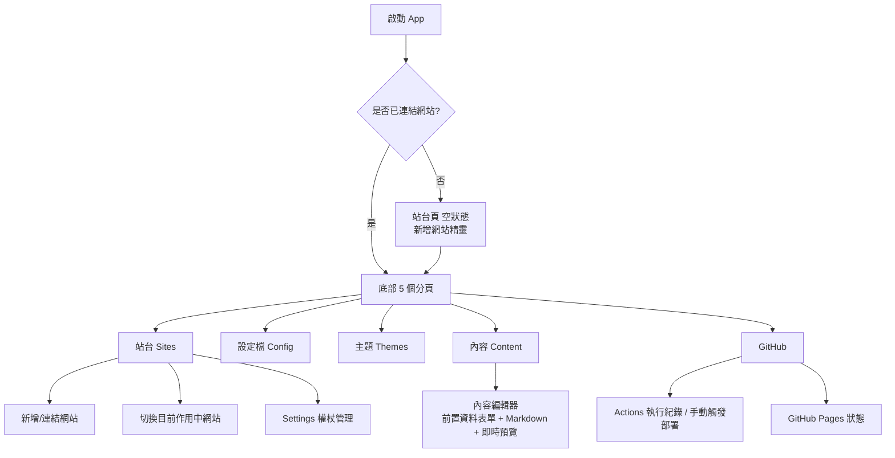

# Hugoer Mobile — 設計文件

參考桌面版 [Hugoer](https://github.com/huang1988pioneer/Hugoer)（Avalonia / .NET 桌面 Hugo 工作台），為 Android 與 iOS 設計、打造行動版友善的「Hugo 網站管理副手」App。

## 1. 為什麼不是直接把桌面版搬過去

桌面版的核心能力建立在三件行動裝置做不到（或不該做）的事情上：

| 桌面版行為 | 手機的限制 |
| --- | --- |
| 呼叫本機 `hugo` / `git` / `gh` 執行檔（`ProcessRunner`） | iOS 完全禁止執行下載的可執行檔；Android 也不建議、且無法保證使用者裝置有這些工具 |
| 直接讀寫本機檔案系統的 Hugo 專案資料夾 | 手機沒有「一個資料夾即一個網站」的概念，App 沙盒也無法穩定存取任意路徑 |
| 本機 `hugo server` 即時預覽整站（含主題樣板） | 在手機上重現完整 Hugo 渲染引擎成本過高，且不符合「隨手改一篇文章」的行動情境 |

因此手機版的定位改為 **「Hugo 網站的隨身管理副手」**：透過 **GitHub REST API** 直接讀寫 repo 內容、編修設定、管理主題設定、觸發 GitHub Actions 建置與查詢 GitHub Pages 狀態、以及對單篇 Markdown 文章做前置資料（front matter）+ 內文的即時預覽。真正的 `hugo build` 交給 GitHub Actions（桌面版本來就已內建產生 `hugo.yml` workflow）執行。

這個定位不是「閹割版」，而是刻意針對行動情境優化的互補工具：桌面版負責「建站、裝主題、大規模編修」，手機版負責「隨手改文章、盯建置狀態、緊急修正 baseURL、手機上就能發佈」。

## 2. 技術選型

- **Android 原生 Kotlin + Jetpack Compose / Material 3**：使用 Android ViewModel + StateFlow、OkHttp、EncryptedSharedPreferences，以及原生 Markdown／圖片／影片／PDF 預覽元件。
- **iOS 原生 Swift + SwiftUI**：使用 ObservableObject + `@Published`、Swift Concurrency、URLSession、Keychain Services，以及 SwiftUI／AVKit／PDFKit 原生預覽元件。
- 兩個平台分別使用原生 UI 與安全儲存，符合各自的生命週期、無障礙、導覽與發布工具鏈；GitHub API、TOML、Front Matter、Markdown 的行為維持一致。
- **GitHub REST API v3**（`api.github.com`）＋ Personal Access Token（PAT）：取代 `gh` CLI。
- 兩個原生版本都使用輕量、無第三方 parser 的 Markdown → HTML 預覽與 TOML reader/writer，避免跨平台 runtime 依賴。

## 3. 資訊架構（畫面地圖）



底部 Tab 對應桌面版分頁：

| 桌面分頁 | 手機分頁 | 對應調整 |
| --- | --- | --- |
| 環境 | **站台**（Sites） | 「環境」在手機上不再是安裝 Hugo，而是「管理已連結的 GitHub repo（網站）＋目前作用中網站」 |
| 設定檔 | **設定檔**（Config） | 基本欄位 / Params 表單 / 原始 TOML 三個分段，邏輯與桌面版 `TomlParamsService` 相同 |
| 主題 | **主題**（Themes） | 顯示目前 `theme` 設定 + 精選主題目錄（含桌面版可一鍵安裝的 Stack 等），一鍵套用僅更新設定值，安裝／新增 submodule 之類的重度操作導回桌面版 |
| 內容 | **內容**（Content） | 瀏覽 `content/`、新增/刪除文章、Markdown 即時預覽 |
| GitHub | **GitHub** | 權限檢查、Actions 執行紀錄與手動觸發、Pages 狀態、開啟已發佈網站 |

「站台」內含齒輪圖示進入 **Settings**（PAT 管理、清除快取、關於）。

## 4. 行動友善 UI 設計原則

1. **原生底部分頁導覽**：Android 使用 Material 3 `NavigationBar`，iOS 使用 SwiftUI `TabView`，5 個常駐分頁符合平台慣例。
2. **單手可達的觸控目標**：Android 可點擊列高 ≥ 48dp、iOS 按鈕最小 44×44pt，重要動作固定在畫面下緣的主要按鈕。
3. **原生手勢取代選單**：Android 使用 `SwipeToDismissBox` / Pull-to-refresh，iOS 使用 `.swipeActions` / `.refreshable`。
4. **漸進式表單**：設定檔/前置資料使用分段控制與摺疊區塊，避免一次塞爆直向長表單。
5. **離線可讀、線上可寫的取捨**：讀取結果保留在 App 狀態與本機 profile；寫入、套用設定、觸發部署需要網路，並清楚呈現未儲存狀態與錯誤訊息。
6. **外觀**：桌面版固定暖墨色底與銅色重點。Android 與 iOS 使用同一套銅棕色，並跟隨系統淺色／深色，不採用桌布動態取色。
7. **鍵盤最佳化**：baseURL 使用 URL keyboard；Tags/Categories 用逗號分隔；Markdown 編輯器提供適合觸控的編輯/預覽切換。
8. **危險操作二次確認**：刪除文章、覆蓋遠端設定前跳出原生確認對話框。
9. **狀態先於資料**：GitHub 分頁優先呈現建置狀態大卡片，細節往下捲動才看到。

## 5. 資料與服務對照

| Model/Service（桌面 `Services/`） | 手機對應 | 說明 |
| --- | --- | --- |
| `ProcessRunner` + `git`/`gh` CLI | `android/.../GitHubApiService.kt` / `ios/.../GitHubApiService.swift` | 改用 GitHub REST API（OkHttp / URLSession + PAT） |
| `ContentService`（本機檔案） | Android/iOS Content ViewModel + Contents API | 以 repo 內 `content/` 目錄取代本機資料夾 |
| `FrontMatterService` | Android/iOS Front Matter service | 純字串處理，依照桌面版規則重寫 |
| `TomlParamsService` | Android/iOS TOML services | 輕量 TOML reader/writer，保留 Hugo/Stack 常用欄位 |
| `MarkdownPreviewService` | Android/iOS `ArticlePreview` | 單篇文章 Markdown、常見 Hugo shortcode 與圖片／影片／PDF 媒體原生預覽，非整站樣板渲染 |
| `HugoConfigService` | Android/iOS Config ViewModel + ConfigLocator | 嘗試 `hugo.toml` / `config.toml` / `config/_default/hugo.toml` |
| `ThemeService`（本機安裝） | Android/iOS ThemeCatalogService | 精選主題目錄 + 更新 `theme` 設定值；實際安裝導回桌面版 |
| `GitHubService`（`gh`/`git` CLI） | Android/iOS GitHubApiService | Repo、Contents、Actions、Pages 全部改走 REST API |
| N/A | Android EncryptedSharedPreferences / iOS Keychain | PAT 安全儲存 |
| N/A | Android SharedPreferences / iOS Application Support JSON | 多個已連結網站設定（不含 token）持久化 |

## 6. GitHub Personal Access Token 權限需求

建議使用 **Fine-grained personal access token**，限定單一或多個 repository，權限：

- Contents：Read and write（讀寫 `content/`、`hugo.toml` 等）
- Actions：Read and write（查詢與觸發 workflow）
- Pages：Read and write（查詢/啟用 GitHub Pages）
- Metadata：Read-only（必要基本權限）

App 內「站台 → 新增網站」會呼叫 `GET /repos/{owner}/{repo}` 驗證權杖與權限，並顯示目前帳號對該 repo 的 push/admin 權限，比照桌面版 `CheckPushAccessAsync` 的使用者體驗。

## 7. 專案結構

```
HugoerMobile/
  android/                 Kotlin + Jetpack Compose 原生 Android App
    app/src/main/java/com/hugoer/mobile/
      data/ remote/ service/ toml/ ui/
  ios/                     Swift + SwiftUI 原生 iOS App
    HugoerMobile/Models, Services, ViewModels, Views
    project.yml            XcodeGen 設定
  legacy-maui/             第一版 .NET MAUI 原型（僅供參考）
```

## 8. 建置與發布需求

- Android：需要 Android SDK、Java 17+、Gradle；`gradle :app:assembleRelease` 可產生 release APK。
- iOS：需要 macOS、Xcode；`xcodebuild` 可建置 Simulator 版本。
- iOS 正式 IPA：需要 Apple Developer Team、Distribution certificate、provisioning profile 與發布權限；沒有 signing credentials 時只能建置 Simulator `.app`，不能產生可安裝的正式 IPA。

## 9. 後續可擴充方向

- 生物辨識解鎖（Face ID / 指紋）保護 PAT 存取，可用 `Plugin.Fingerprint` 或原生 API。
- 背景推播：Actions 執行完成時透過 GitHub Webhook + 自架小型通知後端，推播「部署成功/失敗」。
- 分享擴充（Share Extension / Android Share Target）：從相簿分享圖片直接建立一篇附圖文章。
- 多 GitHub 帳號／組織 repo 選擇器（`GET /user/repos`）。
- Widget / App Shortcut：「新增一篇文章」捷徑。
