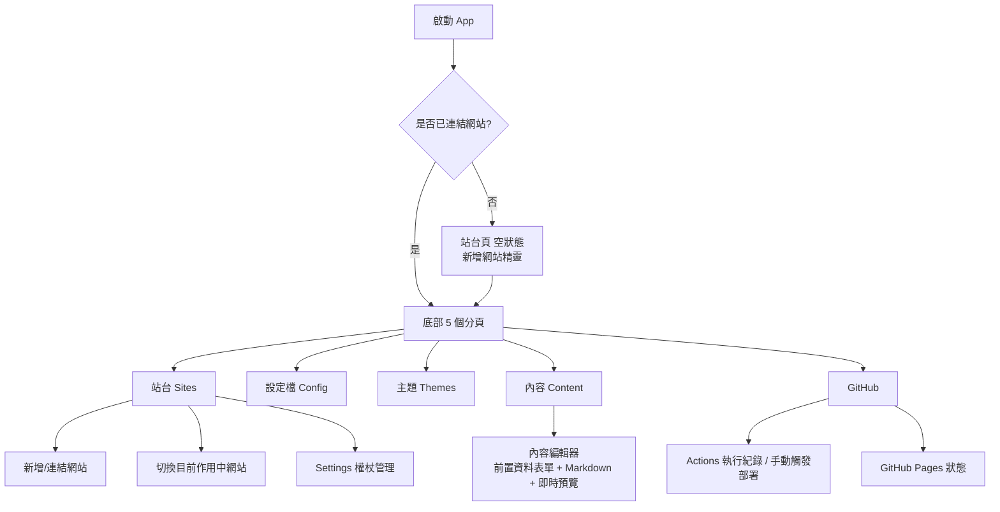

# Hugoer Mobile — 設計文件

參考桌面版 [Hugoer](https://github.com/huang1988pioneer/Hugoer)（Avalonia / .NET 桌面 Hugo 工作台），為 Android 與 iOS 設計、打造行動版友善的「Hugo 網站管理副手」App。

## 1. 為什麼不是直接把桌面版搬過去

桌面版的核心能力建立在三件行動裝置做不到（或不該做）的事情上：

| 桌面版行為 | 手機的限制 |
| --- | --- |
| 呼叫本機 `hugo` / `git` / `gh` 執行檔（`ProcessRunner`） | iOS 完全禁止執行下載的可執行檔；Android 也不建議、且無法保證使用者裝置有這些工具 |
| 直接讀寫本機檔案系統的 Hugo 專案資料夾 | 手機沒有「一個資料夾即一個網站」的概念，App 沙盒也無法穩定存取任意路徑 |
| 本機 `hugo server` 即時預覽整站（含主題樣板） | 在手機上重現完整 Hugo 渲染引擎成本過高，且不符合「隨手改一篇文章」的行動情境 |

因此手機版的定位改為 **「Hugo 網站的隨身管理副手」**：透過 **GitHub REST API** 直接讀寫 repo 內容、編修設定、管理主題設定、觸發 GitHub Actions 建置與查詢 GitHub Pages 狀態、以及對單篇 Markdown 文章做前置資料（front matter）+ 內文的即時預覽。真正的 `hugo build` 交給 GitHub Actions（桌面版本來就已內建產生 `hugo.yml` workflow）執行。

這個定位不是「閹割版」，而是刻意針對行動情境優化的互補工具：桌面版負責「建站、裝主題、大規模編修」，手機版負責「隨手改文章、盯建置狀態、緊急修正 baseURL、手機上就能發佈」。

## 2. 技術選型

- **.NET MAUI**（單一 C# 專案，同時產出 Android / iOS），原因：
  - 與桌面版同語言（C#）、同 MVVM 慣例，`CommunityToolkit.Mvvm`、`Markdig`、`Tomlyn` 三個桌面版已用的套件可以**原封不動**在手機端使用（皆為純 .NET / 無 OS 相依）。
  - `FrontMatterService`、`TomlParamsService` 的邏輯幾乎可以直接從桌面版移植（純字串/TOML 處理，無檔案系統相依），降低重工。
  - 團隊只需維護一套 C# 邏輯即可涵蓋 Android + iOS + （未來）Mac Catalyst / Windows。
- **CommunityToolkit.Maui**：RefreshView、Snackbar/Toast、載入指示器等行動 UX 元件。
- **GitHub REST API v3**（`api.github.com`）＋ Personal Access Token（PAT）：取代 `gh` CLI。
- **Markdig**：本地即時把 Markdown body 轉 HTML，丟進 `WebView` 預覽（不含主題樣板，但足以檢查排版、圖片、程式碼區塊）。
- **SecureStorage**（MAUI 內建，Android Keystore / iOS Keychain）：保存 GitHub PAT，絕不落地成一般偏好設定或明碼檔案。

## 3. 資訊架構（畫面地圖）



底部 Tab 對應桌面版分頁：

| 桌面分頁 | 手機分頁 | 對應調整 |
| --- | --- | --- |
| 環境 | **站台**（Sites） | 「環境」在手機上不再是安裝 Hugo，而是「管理已連結的 GitHub repo（網站）＋目前作用中網站」 |
| 設定檔 | **設定檔**（Config） | 基本欄位 / Params 表單 / 原始 TOML 三個分段，邏輯與桌面版 `TomlParamsService` 相同 |
| 主題 | **主題**（Themes） | 顯示目前 `theme` 設定 + 精選主題目錄（含桌面版可一鍵安裝的 Stack 等），一鍵套用僅更新設定值，安裝／新增 submodule 之類的重度操作導回桌面版 |
| 內容 | **內容**（Content） | 瀏覽 `content/`、新增/刪除文章、Markdown 即時預覽 |
| GitHub | **GitHub** | 權限檢查、Actions 執行紀錄與手動觸發、Pages 狀態、開啟已發佈網站 |

「站台」內含齒輪圖示進入 **Settings**（PAT 管理、清除快取、關於）。

## 4. 行動友善 UI 設計原則

1. **底部分頁導覽（Shell TabBar）**：5 個常駐分頁，符合 iOS/Android 原生分頁慣例，優於桌面版的側邊/頂端分頁列。
2. **單手可達的觸控目標**：可點擊列高 ≥ 48dp、按鈕最小 44×44pt，重要動作（儲存、部署）固定在畫面下緣的主要按鈕，而非工具列小圖示。
3. **手勢取代選單**：內容列表用 `SwipeView` 左滑刪除，取代桌面版的右鍵選單；`RefreshView` 下拉重整取代手動「重新整理」按鈕。
4. **漸進式表單**：設定檔/前置資料使用「分段（Segmented）＋ 摺疊區塊」，避免一次塞爆一個直向捲動的長表單。
5. **離線可讀、線上可寫的取捨**：讀取結果（內容列表、設定檔）快取在記憶體/`Preferences`，離線時仍可瀏覽；任何寫入（儲存文章、套用設定、觸發部署）需要網路，並清楚呈現「未儲存」狀態與錯誤訊息（Snackbar）。
6. **深色模式**：所有色彩以 `AppThemeBinding` 定義，跟隨系統外觀。
7. **鍵盤最佳化**：baseURL 用 `Keyboard="Url"`、Tags/Categories 用逗號分隔的 Chips 輸入、Markdown 編輯器提供上方工具列（粗體/連結/圖片/程式碼）方便觸控插入語法。
8. **危險操作二次確認**：刪除文章、覆蓋遠端設定前跳出 `DisplayAlert` 確認。
9. **狀態先於資料**：GitHub 分頁優先呈現「目前建置狀態」大卡片（成功/建置中/失敗 的顏色與圖示），細節（歷史紀錄）往下捲動才看到。

## 5. 資料與服務對照

| Model/Service（桌面 `Services/`） | 手機對應 | 說明 |
| --- | --- | --- |
| `ProcessRunner` + `git`/`gh` CLI | `Services/GitHubApiService.cs` | 改用 GitHub REST API（HttpClient + PAT） |
| `ContentService`（本機檔案） | `ViewModels/ContentListViewModel.cs` + `GitHubApiService` Contents API | 以 repo 內 `content/` 目錄取代本機資料夾 |
| `FrontMatterService` | `Services/FrontMatterService.cs` | **直接移植**，純字串處理 |
| `TomlParamsService` | `Services/TomlParamsService.cs` | **直接移植**，僅依賴 Tomlyn |
| `MarkdownPreviewService` | `Services/MarkdownPreviewService.cs` | 改為僅轉換單篇文章 body（Markdig），非整站樣板渲染 |
| `HugoConfigService` | `ViewModels/ConfigViewModel.cs` + `ConfigLocator` | 依序嘗試 `hugo.toml` / `config.toml` / `config/_default/hugo.toml` 等常見路徑 |
| `ThemeService`（本機安裝） | `Services/ThemeCatalogService.cs` | 靜態精選主題目錄 + 更新 `theme` 設定值；實際安裝主題導回桌面版 |
| `GitHubService`（`gh`/`git` CLI） | `Services/GitHubApiService.cs` | 建 repo、推送、Actions workflow、Pages 狀態全部改走 REST API |
| N/A | `Services/SecureTokenStore.cs` | PAT 安全儲存（Keychain/Keystore） |
| N/A | `Services/SiteProfileStore.cs` | 多個已連結網站設定（不含 token）持久化 |

## 6. GitHub Personal Access Token 權限需求

建議使用 **Fine-grained personal access token**，限定單一或多個 repository，權限：

- Contents：Read and write（讀寫 `content/`、`hugo.toml` 等）
- Actions：Read and write（查詢與觸發 workflow）
- Pages：Read and write（查詢/啟用 GitHub Pages）
- Metadata：Read-only（必要基本權限）

App 內「站台 → 新增網站」會呼叫 `GET /repos/{owner}/{repo}` 驗證權杖與權限，並顯示目前帳號對該 repo 的 push/admin 權限，比照桌面版 `CheckPushAccessAsync` 的使用者體驗。

## 7. 專案結構

```
HugoerMobile/
  HugoerMobile.sln
  HugoerMobile/
    HugoerMobile.csproj
    MauiProgram.cs
    App.xaml(.cs)
    AppShell.xaml(.cs)
    Platforms/Android, Platforms/iOS
    Models/            對應資料模型
    Services/          GitHubApiService、TomlParamsService、FrontMatterService、MarkdownPreviewService、SecureTokenStore、SiteProfileStore、ThemeCatalogService
    ViewModels/        CommunityToolkit.Mvvm ObservableObject + RelayCommand
    Views/             Shell 分頁與子頁面 XAML
    Resources/Styles    行動友善的顏色/樣式資源
```

## 8. 建置需求

```
dotnet workload install maui
```

- Android：需要 Android SDK（可用 Android Studio 或 `dotnet workload install android`附帶的授權工具安裝）。
- iOS：需要在 macOS 上安裝 Xcode，並透過「配對至 Mac」或直接在 Mac 上以 `dotnet build -t:Run -f net10.0-ios` 建置／偵錯。
- 本沙盒環境未安裝 MAUI workload 與 Android/iOS SDK，因此**本次僅完成程式碼與專案結構的建立，未執行實機/模拟器建置驗證**；請在具備對應工作負載與 SDK 的機器上執行上列指令後再 `dotnet build`。

## 9. 後續可擴充方向

- 生物辨識解鎖（Face ID / 指紋）保護 PAT 存取，可用 `Plugin.Fingerprint` 或原生 API。
- 背景推播：Actions 執行完成時透過 GitHub Webhook + 自架小型通知後端，推播「部署成功/失敗」。
- 分享擴充（Share Extension / Android Share Target）：從相簿分享圖片直接建立一篇附圖文章。
- 多 GitHub 帳號／組織 repo 選擇器（`GET /user/repos`）。
- Widget / App Shortcut：「新增一篇文章」捷徑。
